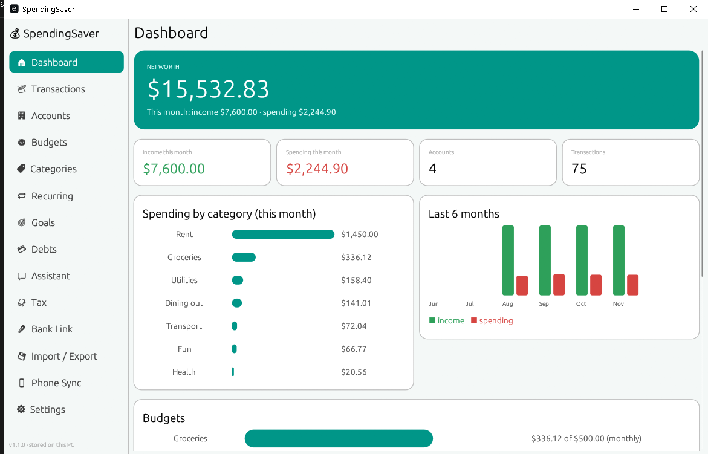
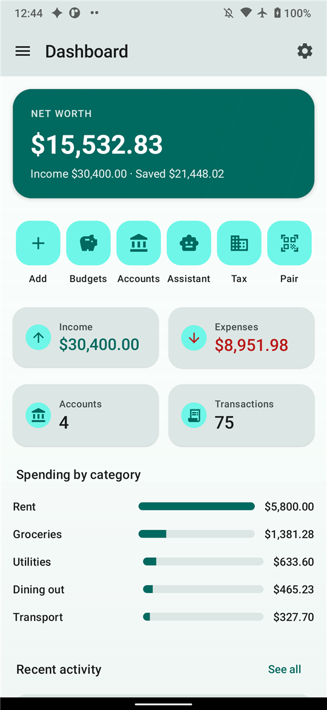

# SpendingSaver

SpendingSaver is a collection of personal-finance applications and integrations
in one repository. The applications are separate projects, not one shared
runtime: in particular, the Android app stores data locally and works fully on
its own. It can optionally pair with the desktop app to sync (see
[`polyglot-app/docs/sync.md`](polyglot-app/docs/sync.md)); nothing syncs unless
you set that up.

## What it looks like

Sample data, not real accounts. Every screen is in the project READMEs:
[Android gallery](SpendingSaverAndroid/README.md#screenshots) and
[desktop gallery](polyglot-app/desktop/README.md#screenshots).

<p align="center">
  
</p>
<p align="center"><sub><b>Desktop</b> (native Rust, opens instantly): net worth, this month, spending by category and the last six months.</sub></p>

<table>
<tr>
<td align="center" valign="top"><br><b>Dashboard</b><br><sub>Net worth and quick actions</sub></td>
<td align="center" valign="top"><br><b>Budgets</b><br><sub>Limits with progress bars</sub></td>
<td align="center" valign="top"><br><b>Tax</b><br><sub>US federal estimate, offline</sub></td>
<td align="center" valign="top"><br><b>Assistant</b><br><sub>Answers on the phone, no network</sub></td>
</tr>
</table>
<p align="center"><sub><b>Android</b> (Kotlin and Jetpack Compose): works fully on its own.</sub></p>

## Projects

| Project | Location | Data and runtime |
| --- | --- | --- |
| Android app | [`SpendingSaverAndroid/`](SpendingSaverAndroid/README.md) | Kotlin, Jetpack Compose, Room. Local-first; JSON backup/restore; optional opt-in sync with the desktop backend. |
| Browser app | [`spendingsaver-web/`](spendingsaver-web/README.md) | React, TypeScript, Vite, Dexie/IndexedDB. Runs in the browser. |
| Desktop app | [`polyglot-app/desktop/`](polyglot-app/desktop/README.md) | Native Rust GUI (egui) with its own local SQLite database. Opens instantly; no web view, no background services. Optional phone sync. |
| Backend (optional) | [`polyglot-app/`](polyglot-app/README.md) | Python FastAPI backend and Go service used by the MCP adapter and the API. |
| MCP integration | [`spendingsaver-mcp/`](spendingsaver-mcp/README.md) | Model Context Protocol tools that call the desktop backend's HTTP API. |

The product requirements and implementation status are in the
[SpendingSaver specification](spec/SPEC.md).

## Quick start

Each project has its own dependencies and setup. For example, from the
repository root:

```powershell
# Browser app
Set-Location spendingsaver-web
npm ci
npm run dev
```

```powershell
# Android debug build (JDK 17 and Android SDK platform 34 required)
Set-Location SpendingSaverAndroid
.\gradlew.bat :app:assembleDebug
```

For desktop development, backend/API operations, tests, and packaging, see the
[`polyglot-app` README](polyglot-app/README.md) and
[operator runbook](polyglot-app/docs/runbook.md).

## Repository guidance

- Read [`AGENTS.md`](AGENTS.md) before making changes.
- Current cross-project work and known follow-ups are tracked in
  [`PLAN.md`](PLAN.md) and [`TODO.md`](TODO.md).
- [`HANDOVER.md`](HANDOVER.md) summarizes current project boundaries and
  verification context for the next contributor.
- Treat project-specific build files and READMEs as authoritative for commands
  and dependencies. There is no root-level build that builds every project.

## Privacy and data boundaries

The browser app, Android app, and desktop/backend stack are separate data
stores. Do not assume that data entered into one app is available in another:
only an Android device you have explicitly paired with a desktop backend syncs
accounts, categories, transactions and budgets with it.
The MCP server can call mutating backend operations; only point it at a backend
you trust. Do not expose a development backend to an untrusted network.
