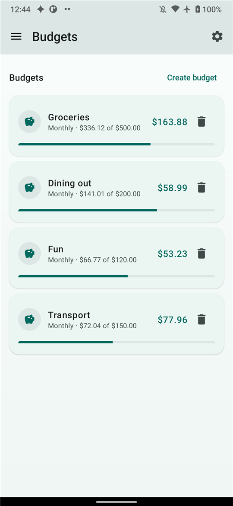
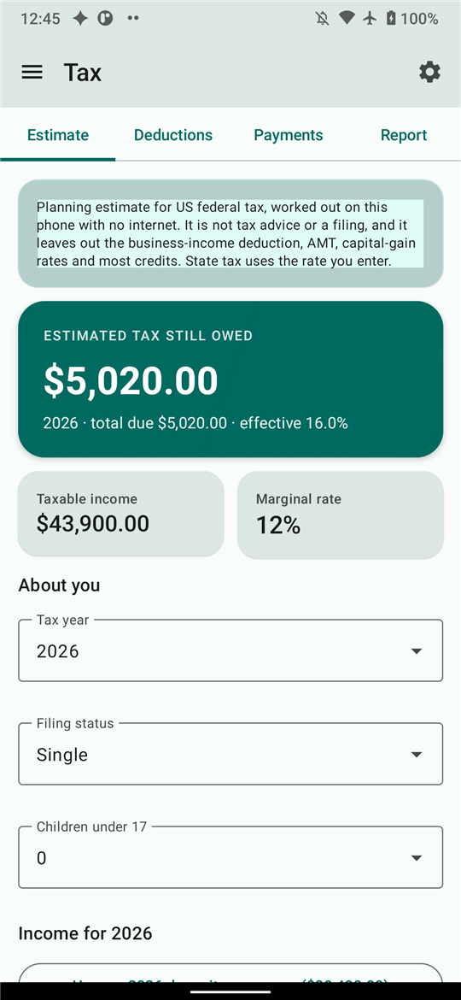
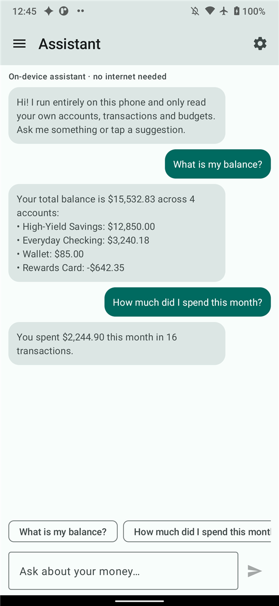

# SpendingSaver

SpendingSaver is a collection of personal-finance applications and integrations
in one repository. The applications are separate projects, not one shared
runtime: in particular, the Android app stores data locally and works fully on
its own. It can optionally pair with the desktop app to sync (see
[`spendingsaver-desktop/docs/sync.md`](spendingsaver-desktop/docs/sync.md)); nothing syncs unless
you set that up.

## Install SpendingSaver

You do not need an account, and you do not need to know anything about GitHub. You just download one file and open it.

**Step 1. Open the download page:** [github.com/LoopyLuci/SpendingSaver/releases/latest](https://github.com/LoopyLuci/SpendingSaver/releases/latest)

**Step 2. Scroll down to the box called "Assets"** (near the bottom of the page) and click the file for your device:

| You have | Click this file | What it is |
| --- | --- | --- |
| A **Windows** PC (Windows 10 or 11) | `SpendingSaver-Setup-1.1.3.exe` | The installer for the computer app |
| An **Android** phone or tablet (Android 8 or newer, almost every phone from 2017 on) | `SpendingSaver-1.1.3-universal.apk` | The phone app (the main "Universal" version) |
| An **older or 32-bit** Android device (Android 5 to 7, or a device the main file says it cannot install on, such as older Amazon Fire tablets) | `SpendingSaver-1.1.3-legacy.apk` | The same app without the optional remote-sync extra; everything else works |

Ignore the other files (`Source code` and `SHA256SUMS.txt`); they are for developers. If the version number in the file name is newer than 1.1.3, that is fine, pick the same kind of file.

**Step 3. Open the file you downloaded** and follow the steps for your device below. Your device will probably show a few warnings first. That is normal and explained below.

> **Why are there warnings at all?** Windows and Android show a warning for any app that does not come from their own store *or* whose maker has not paid a yearly fee for a "known publisher" badge. SpendingSaver is free and open source, so it has neither. The warning does not mean anything was found wrong with the file. It only means "we do not recognise this publisher yet". The app's complete source code is public in this repository, it keeps your data on your own device, and it only uses the internet for the optional features you switch on yourself. Only download it from the official page linked above.

<details>
<summary><b>Windows: step by step (click to open)</b></summary>

1. **Download.** Click `SpendingSaver-Setup-1.1.3.exe`. Your browser saves it to your **Downloads** folder.
   - Edge or Chrome may say *"SpendingSaver-Setup… isn't commonly downloaded"* or *"couldn't be verified"*. This is the "unknown publisher" notice. Click the **three dots (…)** next to the download, choose **Keep**, then **Keep anyway** (in Edge you may need to click **Show more** first).
2. **Open it.** Double-click the file in your Downloads folder.
3. **If a blue window says "Windows protected your PC"** (this is called SmartScreen): click the small words **More info**, then click the **Run anyway** button that appears. Windows shows this for every new app from a small maker. It is not a virus alert.
4. **Follow the installer.** Click **Next**, then **Install**, then **Finish**. It does not ask for an administrator password because it installs only for your Windows user. It adds **SpendingSaver** to your Start menu and puts a shortcut on your desktop.
5. **Start it** from the desktop shortcut or the Start menu. It opens right away.

**Other things you might see**
- *Your antivirus program asks about the file.* Some antivirus programs are cautious with new apps. If yours does, choose to allow it. If you would like extra reassurance, see "Checking the file" below.
- *"Windows Defender Firewall has blocked some features".* This only appears if you turn on **Phone Sync**. Tick **Private networks** and click **Allow access** so your phone can reach your computer at home. You can skip it if you never sync.
- *"Do you want to allow this app to make changes to your device?"* You should not see this one. If you do, the file is probably not the official one.

**Your data and uninstalling.** Your information is saved in a single file in your user folder (`%APPDATA%\SpendingSaver`). To remove the app, open **Settings → Apps → Installed apps**, find **SpendingSaver** and choose **Uninstall**. Uninstalling keeps your data file, so a later reinstall picks up where you left off.

**Updating.** Download the newer installer from the same page and run it. It replaces the old version and keeps your data.

</details>

<details>
<summary><b>Android: step by step (click to open)</b></summary>

1. **On your phone**, open the download page link above in your browser (Chrome, Samsung Internet, Firefox, and so on). Scroll to **Assets** and tap `SpendingSaver-1.1.3-universal.apk` (or `-legacy.apk` for an older device).
   - Your browser may say *"This type of file can harm your device"* or *"File may be harmful"*. Android shows this for every app that is installed from a file instead of from Google Play. Tap **OK** or **Download anyway**.
2. **Open the file.** Tap **Open** when the download finishes, or open your **Downloads** app (or **Files**) and tap `SpendingSaver-1.1.3-universal.apk` (or `-legacy.apk` for an older device).
3. **If your phone says it can't install from this source.** You will see something like *"For your security, your phone is not allowed to install unknown apps from this source"*. This is Android's normal protection. Tap **Settings**, switch on **Allow from this source**, then press the **back** arrow and tap **Install**. This permission applies only to the browser or file app you used. You can switch it off again afterwards.
4. **Tap Install**, then **Open**.

**Other messages, by phone and Android version**
- **Google "Play Protect" says *"Blocked"*, *"App not scanned"* or *"Unknown developer"*** (Android 8 to 15, most phones). Play Protect is Google's built-in checker. It has simply not seen this app before. Tap **More details** (sometimes **Details**), then **Install anyway** (or **Install without scanning**). If asked, choose **Don't send**. You do not need to do anything else.
- **Samsung phones with "Auto Blocker" (One UI 6.1 or newer).** If it says *"Blocked by Auto Blocker"*, open **Settings → Security and privacy → Auto Blocker** and switch it **off**. Install the app, then switch it back on if you like.
- **Xiaomi, Redmi and POCO phones** may show a *"Security scan"* or *"Risky app"* screen. Tap **Install anyway** (or **Done** then **Install**). If asked for a Mi account, you can usually skip it.
- **Huawei, Honor, OPPO, Vivo and other brands** may show their own version of the same notices ("unknown source", "security check"). The wording differs but the idea is the same: allow this install once. Choose the option that lets the install continue (words like **Allow**, **Continue**, **Install anyway**).
- **Android 7 or older.** Not supported. The app needs Android 8 or newer.
- **"App not installed" or "There was a problem parsing the package".** The download was probably cut short. Delete the file and download it again. If the message says it *conflicts with an existing package*, an older copy signed differently is on your phone; export a backup from its **Settings**, uninstall the old copy, then install again.

**Updating.** Open the app, go to **App updates** in the menu and tap **Check for updates**. It can download the new version and ask you to confirm the install. By default it only checks when you tap the button.

**Your data.** Everything stays on your phone. You can save a backup from **Settings → Export backup**.

</details>

<details>
<summary><b>Checking the file (optional, for the careful)</b></summary>

Every release includes a file called `SHA256SUMS.txt`: a fingerprint for each download. If the fingerprint of your downloaded file matches, the file is exactly the one that was published.

- **Windows:** open **PowerShell** in your Downloads folder and run `Get-FileHash .\SpendingSaver-Setup-1.1.3.exe`. Compare the long code with the matching line in `SHA256SUMS.txt`.
- **Android:** the app's updater does this check by itself whenever it downloads an update.

The Android app is signed with a key that stays the same from release to release, which is how Android knows an update really comes from the same maker. Its fingerprint is `90:EE:55:14:8B:48:96:E8:FB:1A:14:92:9D:B9:0C:D7:9A:B0:1D:12:3B:C2:22:E7:75:A8:14:DB:5C:CC:0D:E5`. The Windows installer is not signed with a purchased certificate, which is why Windows asks for your confirmation.

</details>

Using both? Install both, then follow **Phone Sync** in the desktop app to pair them. Each app works fully on its own.

## What it looks like

Sample data, not real accounts. Every screen is in the project READMEs:
[Android gallery](SpendingSaverAndroid/README.md#screenshots) and
[desktop gallery](spendingsaver-desktop/desktop/README.md#screenshots).

<p align="center">
  
</p>
<p align="center"><sub><b>Desktop</b> (native Rust, opens instantly): net worth, this month, spending by category and the last six months.</sub></p>

<table>
<tr>
<td align="center" valign="top"><br><b>Dashboard</b><br><sub>Net worth and quick actions</sub></td>
<td align="center" valign="top"><br><b>Budgets</b><br><sub>Limits with progress bars</sub></td>
<td align="center" valign="top"><br><b>Tax</b><br><sub>US federal estimate, offline</sub></td>
<td align="center" valign="top"><br><b>Assistant</b><br><sub>Answers on the phone, no network</sub></td>
</tr>
</table>
<p align="center"><sub><b>Android</b> (Kotlin and Jetpack Compose): works fully on its own.</sub></p>

## Projects

| Project | Location | Data and runtime |
| --- | --- | --- |
| Android app | [`SpendingSaverAndroid/`](SpendingSaverAndroid/README.md) | Kotlin, Jetpack Compose, Room. Local-first; JSON backup/restore; optional opt-in sync with the desktop backend. |
| Browser app | [`spendingsaver-web/`](spendingsaver-web/README.md) | Installable offline PWA (React, TypeScript, Vite, IndexedDB). Local-only data; reads and writes the Android/desktop JSON backup; no sync yet. |
| Desktop app | [`spendingsaver-desktop/desktop/`](spendingsaver-desktop/desktop/README.md) | Native Rust GUI (egui) with its own local SQLite database. Opens instantly; no web view, no background services. Optional phone sync. |
| Backend (optional) | [`spendingsaver-desktop/`](spendingsaver-desktop/README.md) | Python FastAPI backend and Go service used by the MCP adapter and the API. |
| MCP integration | [`spendingsaver-mcp/`](spendingsaver-mcp/README.md) | Model Context Protocol tools that call the desktop backend's HTTP API. |

The product requirements and implementation status are in the
[SpendingSaver specification](spec/SPEC.md).

## Quick start

Each project has its own dependencies and setup. For example, from the
repository root:

```powershell
# Browser app
Set-Location spendingsaver-web
npm ci
npm run dev
```

```powershell
# Android debug build (JDK 17 and Android SDK platform 34 required)
Set-Location SpendingSaverAndroid
.\gradlew.bat assembleDebug
```

For desktop development, backend/API operations, tests, and packaging, see the
[`spendingsaver-desktop` README](spendingsaver-desktop/README.md) and
[operator runbook](spendingsaver-desktop/docs/runbook.md).

## Repository guidance

- Read [`AGENTS.md`](AGENTS.md) before making changes.
- Current cross-project work and known follow-ups are tracked in
  [`PLAN.md`](PLAN.md) and [`TODO.md`](TODO.md).
- [`HANDOVER.md`](HANDOVER.md) summarizes current project boundaries and
  verification context for the next contributor.
- Treat project-specific build files and READMEs as authoritative for commands
  and dependencies. There is no root-level build that builds every project.

## Privacy and data boundaries

The browser app, Android app, and desktop/backend stack are separate data
stores. Do not assume that data entered into one app is available in another:
only an Android device you have explicitly paired with a desktop backend syncs
accounts, categories, transactions and budgets with it.
The MCP server can call mutating backend operations; only point it at a backend
you trust. Do not expose a development backend to an untrusted network.
