# SpendingSaver Android

The Android app is a local-first personal finance app built with Kotlin,
Jetpack Compose, Room, and Hilt. Accounts, categories, transactions, and budgets
are stored on the device and the app is fully usable on its own. It can
optionally pair with the SpendingSaver desktop backend to sync those four
datasets; nothing is sent until you pair and tap **Sync now**.

## Screenshots

Taken on a Nokia 7.2 with sample data.

<table>
<tr><td align="center" valign="top">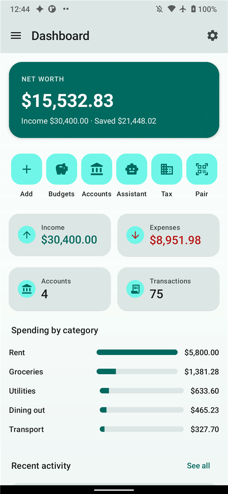<br><b>Dashboard</b><br><sub>Net worth, this month's income and spending, spending by category and recent activity, with quick actions.</sub></td><td align="center" valign="top">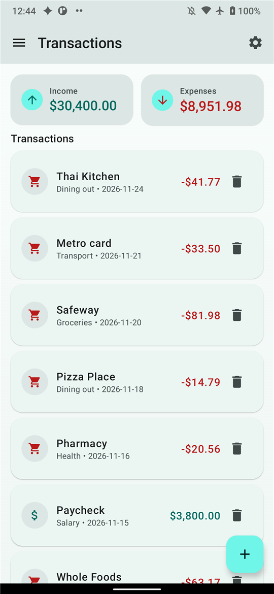<br><b>Transactions</b><br><sub>This month's totals and the latest transactions, with a one-tap add button.</sub></td><td align="center" valign="top">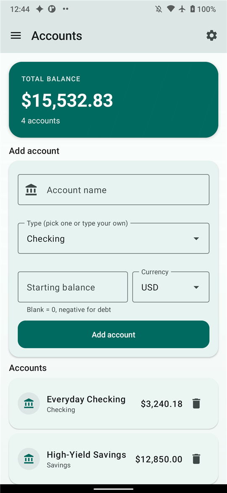<br><b>Accounts</b><br><sub>Add accounts with a type dropdown (or type your own), currency and starting balance.</sub></td><td align="center" valign="top">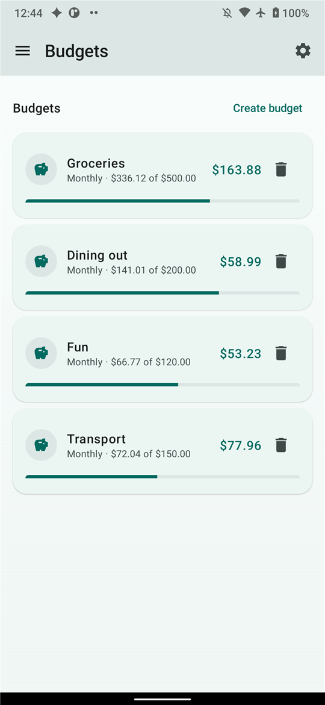<br><b>Budgets</b><br><sub>Monthly, weekly or yearly limits per category with progress bars.</sub></td></tr>
<tr><td align="center" valign="top">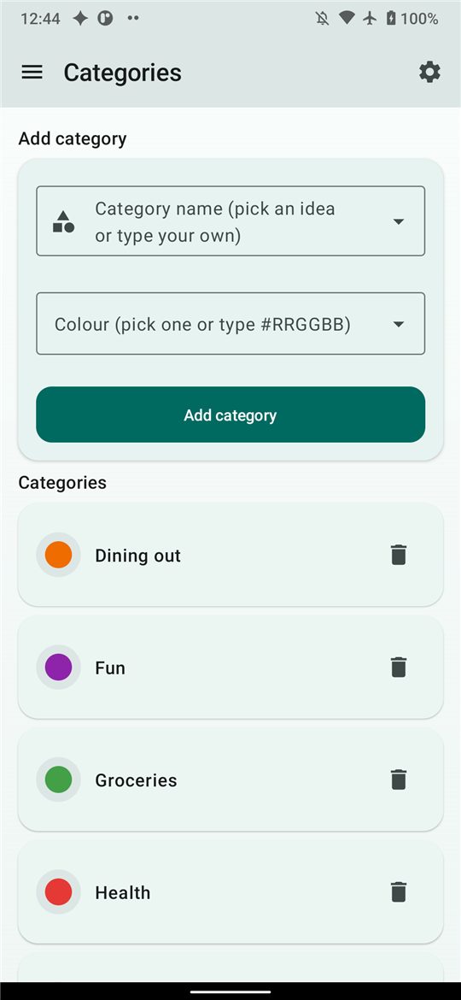<br><b>Categories</b><br><sub>Pick a suggested category name and colour, or type your own.</sub></td><td align="center" valign="top">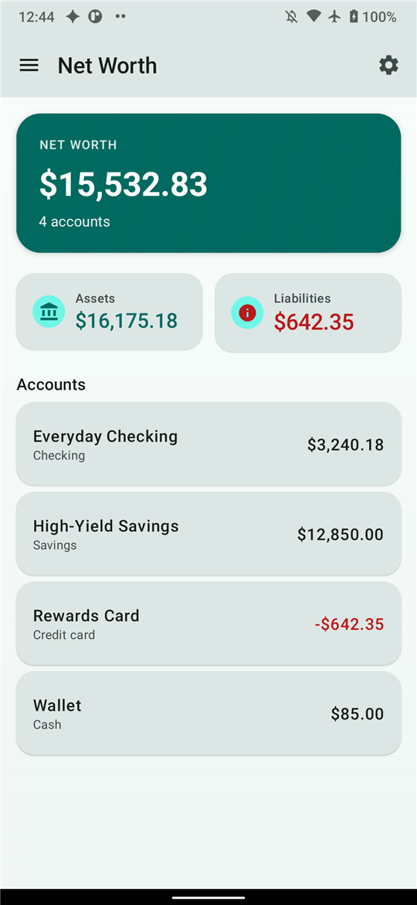<br><b>Net worth</b><br><sub>Assets, liabilities and each account at a glance.</sub></td><td align="center" valign="top">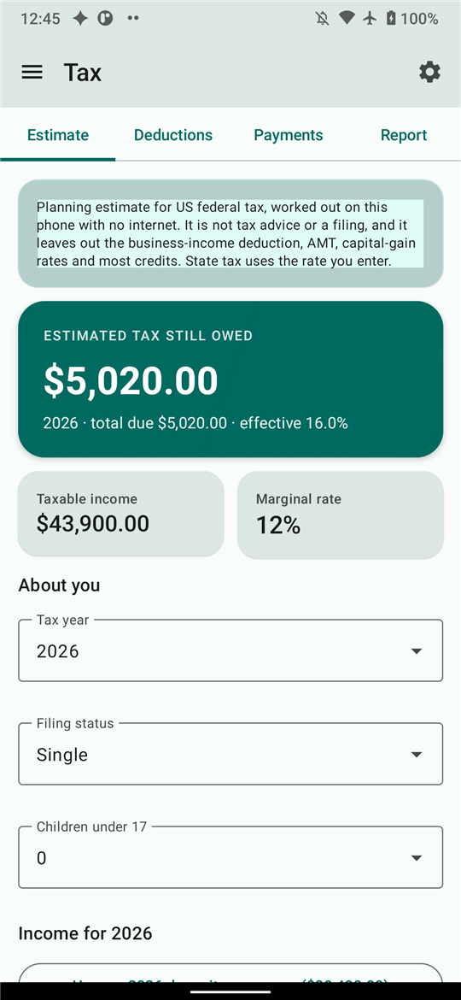<br><b>Tax</b><br><sub>US federal estimate for 2025 and 2026, worked out on the phone with no internet.</sub></td><td align="center" valign="top">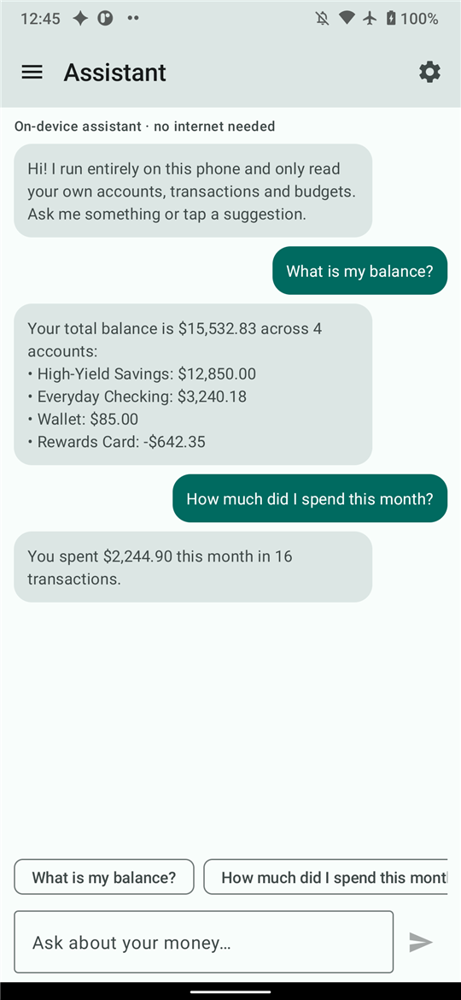<br><b>Assistant</b><br><sub>Ask about balances, spending and budgets. It runs on the phone and never uses a network.</sub></td></tr>
<tr><td align="center" valign="top">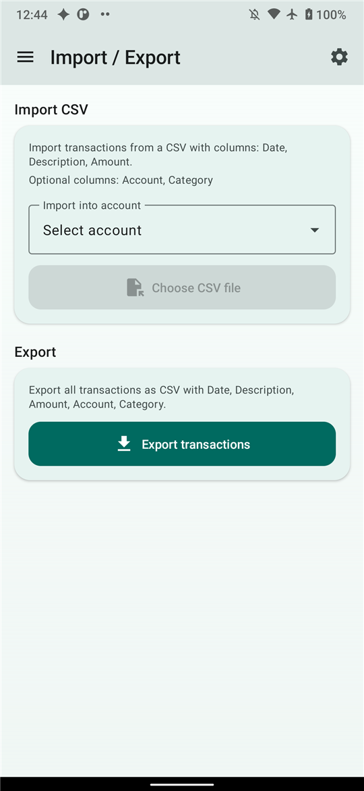<br><b>Import / Export</b><br><sub>Import transactions from CSV and export them.</sub></td><td align="center" valign="top">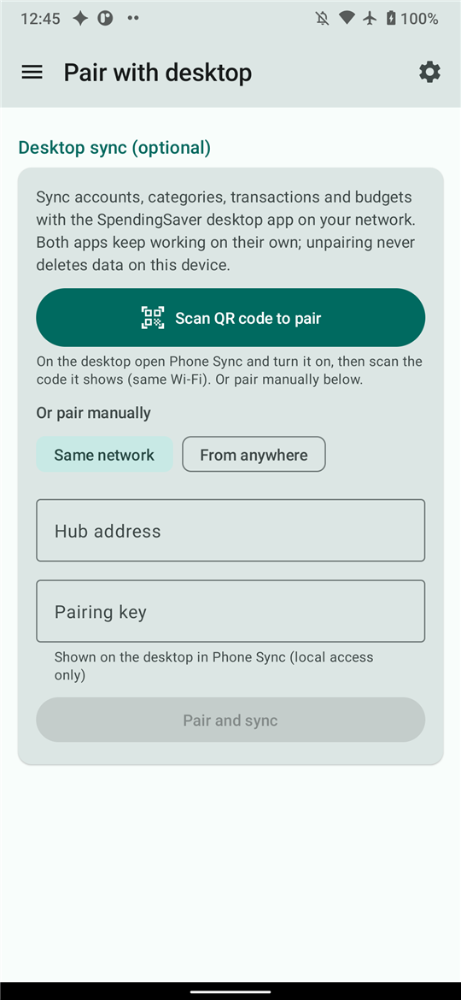<br><b>Pair with desktop</b><br><sub>Optional sync: scan the desktop's QR code or type the address and key.</sub></td><td align="center" valign="top">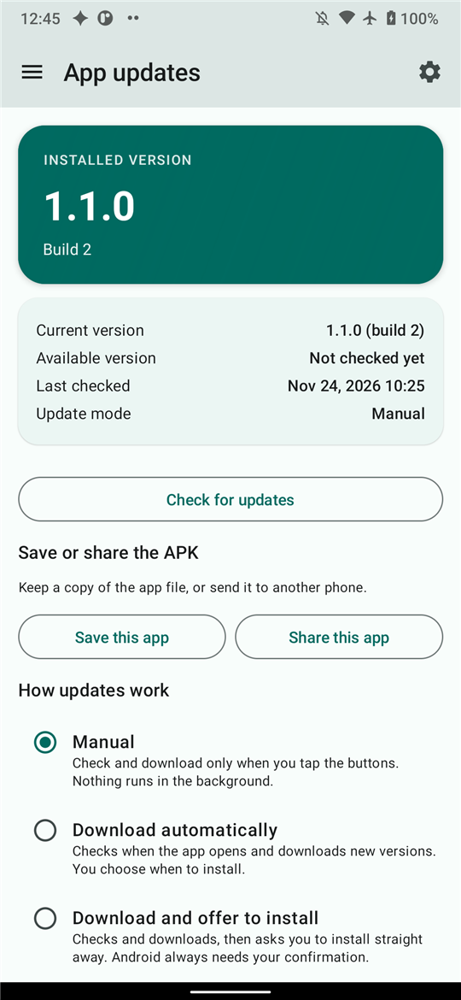<br><b>App updates</b><br><sub>Installed vs available version, manual by default, with save and share of the APK.</sub></td><td align="center" valign="top">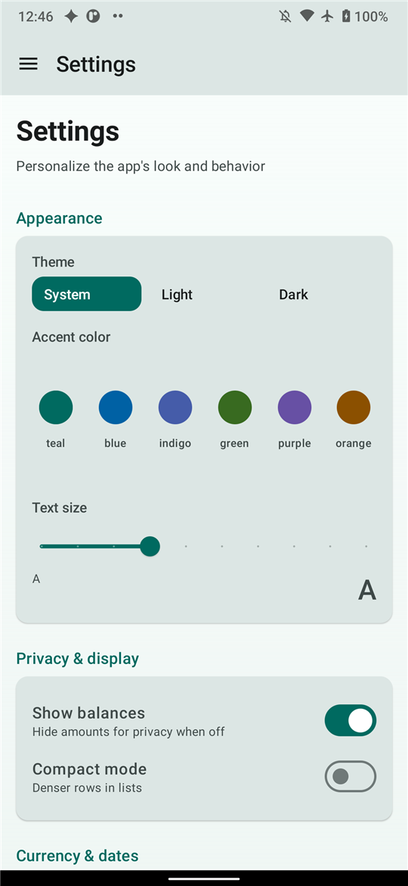<br><b>Settings</b><br><sub>Theme, accent colour, text size, currency, JSON backup and restore.</sub></td></tr>
</table>

## Optional desktop sync

**Settings → Desktop sync (optional)**: enter the desktop backend's address and
its pairing key, then **Pair and sync**. Afterwards **Sync now** pushes your
changes and pulls the desktop's. Last write wins per row; deletes sync;
**Unpair** forgets the hub and never deletes data on the phone. Setup, security
(token storage, `http://` limited to local addresses), merge rules and
troubleshooting: [`spendingsaver-desktop/docs/sync.md`](../spendingsaver-desktop/docs/sync.md).

Stores: the app reads and writes only its own Room database; the sync token and
cursors live in the app-private preferences file `spendingsaver_sync.xml`
(excluded from Android backup). The hub is the desktop backend's SQLite
database. Network use: the `INTERNET` permission and a cleartext-capable network
security config exist for the optional desktop sync only; the app itself only
accepts `http://` hub addresses on local networks.

**Assistant (on-device).** The Assistant screen answers questions about your own
accounts, transactions and budgets using code that runs on the phone
(`ai/AssistantEngine.kt`). It has no model download, no HTTP client and no service
address. The unit test `AssistantEngineTest.aiPackageContainsNoNetworkCode` fails if
networking vocabulary ever appears in the `ai` package. It is a rule-based helper,
not a language model; image generation, image description and voice input were
removed because they cannot run without a model that is not bundled.

## Data backup and restore

Open **Settings → Data & backups** to export or restore a JSON backup using the
Android document picker.

- Export includes active accounts, categories, transactions, and budgets.
- Restore replaces the active contents of those four datasets with the selected
  backup. Export a backup first if you need to preserve the current data. A file
  that is not a complete, supported backup is rejected before anything changes.
  Rows missing from the backup are soft-deleted (kept as tombstones) and
  restored rows are stamped with the restore time, so a restore also wins over
  older data when synced with the desktop.
- Deleted rows, app settings, and other device state are not included.
- Backup files are user-managed files; keep them somewhere safe.

## Build

Requirements: JDK 17 and Android SDK platform 34.

From this directory, build a debug APK with the Gradle wrapper:

```bat
gradlew.bat assembleDebug
```

The project uses Gradle 8.2 and Android Gradle Plugin 8.1.0. Do not replace the
wrapper with a newer Gradle version without checking Android Gradle Plugin
compatibility.

The built APK is at `app/build/outputs/apk/universalDebug/app-universal-debug.apk`.

### Device flavors

| Flavor | Android | CPU | Native Transferd link |
|---|---|---|---|
| `universal` (main) | 8.0+ (API 26) | 64-bit ARM (the link library is arm64) | yes |
| `legacy` | 5.0+ (API 21), uses core-library desugaring | any, including 32-bit | no (LAN sync only) |

Both share one application id and signing key. `scripts/build-release.ps1` builds both and names them
`SpendingSaver-<version>-universal.apk` and `-legacy.apk`; the in-app updater downloads the file that
matches the installed flavor. Build one with `gradlew :app:assembleLegacyRelease`. The `legacy` flavor
has been run on an Android 5.1 (API 22) 32-bit Fire tablet; no other legacy device has been tried.

To install next to an existing build signed with a different key (without
uninstalling it or losing its data), add an application-id suffix:

```bat
gradlew.bat assembleDebug -PdebugAppIdSuffix=.debug
```

Unit tests (JUnit 5/MockK, JVM only):

```bat
gradlew.bat :app:testUniversalDebugUnitTest :app:testLegacyDebugUnitTest
```

Instrumented Room tests (JUnit 4, need a device or emulator; the suffix keeps
your existing app installed):

```bat
gradlew.bat :app:connectedDebugAndroidTest -PdebugAppIdSuffix=.debug
```

Release signing reads `keystore.properties` in this directory (`storeFile`,
`storePassword`, `keyAlias`, `keyPassword`). The file is git-ignored; never
commit it. Without it, release builds are unsigned.

To make a key: `keytool -genkeypair -keystore <path outside the repo>.jks -storetype PKCS12 -alias spendingsaver
-keyalg RSA -keysize 4096 -validity 10950`, then point `storeFile` at it. **Back the key up somewhere safe and
private.** Android only installs an update that is signed with the same key, and the in-app updater checks the same,
so a lost key means users must uninstall to update. A phone with a debug build must uninstall it (this loses its
local data, so export a backup first) before a release-signed build installs.

`app/src/main/baseline-prof.txt` is a baseline profile (installed by `profileinstaller`): it lets Android pre-compile
the start-up and first-screen code so the app opens quickly and scrolls smoothly from the first launch. It is a
hand-written broad profile; regenerate it with a Macrobenchmark run if the screens change a lot.

Release builds are minified and resource-shrunk (R8). `app/proguard-rules.pro`
keeps the classes that Gson reads by field name (backup file, sync wire models,
updater's cached release); keep those rules in step with any new serialised class.

Budgets count expenses in the current calendar window of their period (weekly
Mon–Sun, monthly, yearly); see `util/BudgetPeriod.kt`.

## Local database

Room exports its schema to `app/schemas/` (commit it). When bumping the version,
keep the old JSON, add the `Migration`, and extend
`androidTest/.../MigrationTest.kt` to run it. Only the v3 schema JSON exists, so
the `1 → 2` and `2 → 3` migrations are not covered by an automated test.

Room database schema version 3 removes the former sync outbox and sync metadata.
The `1 → 2` migration converts legacy numeric identifiers to strings, and the
`2 → 3` migration removes sync-only columns while preserving finance records.
Sync needs no schema change: it uses the existing `updatedAt` and `deleted`
columns. The tax profile and the deductible-category tags live in their own
preferences file (`spendingsaver_tax`); they are not synced. The updater's
settings, including an optional access token, are in `spendingsaver_update`,
which is excluded from backups and device transfer.

## Tax

The Tax screen (menu and Dashboard) is a US federal estimator that runs entirely on the phone
(`tax/TaxEngine.kt`, no network, no data pack). It covers tax years 2025 and 2026: standard or itemized
deduction, the seven brackets for all four filing statuses, the child tax credit, self-employment tax,
additional Medicare tax, payroll tax, a state estimate from an effective rate you enter (states with no
wage tax are zero), withholding and estimated payments, a balance or refund, suggested quarterly payments
with due dates, and a shareable text report. *Deductions* tags categories as deductible and totals your
spending in them; *Estimate* can take wages from your recorded deposits for the year.

It is a planning estimate, not tax advice or a filing. It leaves out the qualified business income
deduction, AMT, capital-gain and dividend rates, the earned income and most other credits, and state
rules. The yearly figures (IRS Rev. Proc. 2025-32 for 2026; Social Security wage base 2026 from the SSA)
live in `TaxTables`; update them each year and extend `TaxEngineTest`. Profile and tags are stored on the
device only (`spendingsaver_tax`).

## App updates

*App updates* (menu) shows the installed version, the available version and when it was last checked.
The default mode is **Manual**: nothing contacts the network until you tap *Check for updates*.
Other modes: **Download automatically** (checks when the app opens, at most every 12 hours, and downloads;
you choose when to install) and **Download and offer to install** (the same, then asks you to install).
Automatic downloads default to Wi-Fi only.

- Source: the latest non-draft, non-prerelease GitHub release of `owner/name` (default
  `LoopyLuci/SpendingSaver`, editable), read over HTTPS from `api.github.com`/`github.com` only; redirects
  to any other host are refused.
- The repository is currently **private**, so the feed needs either a public releases repository or a
  read-only access token (entered in the app, kept in `spendingsaver_update`, excluded from backups, sent only to
  GitHub). Attach an `.apk` to each release; GitHub's published SHA-256 digest is verified after download.
- Each download must also be this app's package and have a higher `versionCode` than the installed build.
  Android additionally requires the same signing key, so ship releases signed with the same key (a debug
  build can only update a build from the same machine's debug key).
- **Install** asks first, asks Android's permission to install from this app if needed
  (`REQUEST_INSTALL_PACKAGES`), then opens Android's own installer. An ordinary app cannot install silently;
  the system confirmation is always shown.
- **Save this app / Share this app** copy the running APK (or the downloaded update) to a file you choose or
  the share sheet, through a `FileProvider` limited to the app's `cache/updates` folder.
- `REQUEST_INSTALL_PACKAGES` is a restricted permission on Google Play; a Play Store build should drop the
  updater (Play updates the app itself).
- Verified: version/parse/allow-list/checksum logic (`UpdateLogicTest`), the screen, the share sheet and the
  offline error path on a Nokia 7.2. Not yet verified end to end: a real download and install, because no
  release has been published and that phone has no internet route.

