# SpendingSaver desktop (native)

A native Rust app built with [egui](https://github.com/emilk/egui). No web view, no Tauri, no helper
processes: one executable, one SQLite file. The window appears in about a tenth of a second because start-up is
only "open the database file and read it".

```powershell
cargo run --release        # or: cargo build --release, then run target/release/spendingsaver
cargo test --release       # 33 tests: storage, tax, calculations, sync hub, recurring, assistant, bank import
```

## Screenshots

Sample data. Light theme; dark and system themes are in Settings.

<table>
<tr><td align="center" valign="top">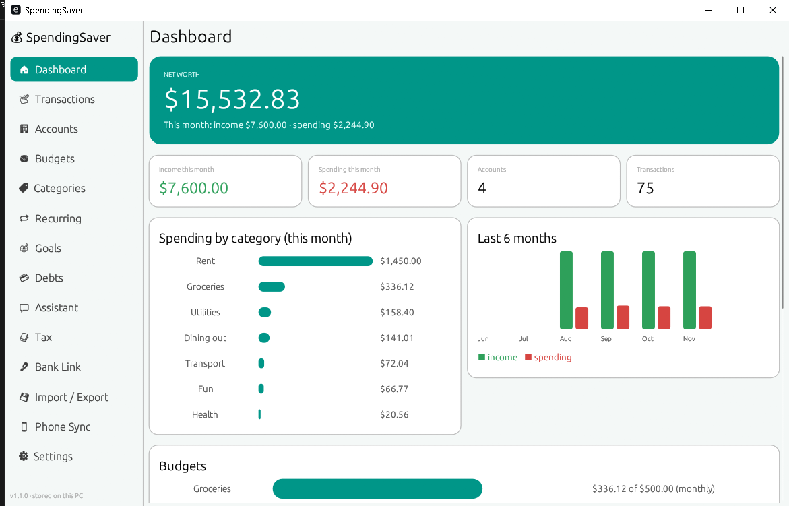<br><b>Dashboard</b><br><sub>Net worth, income and spending this month, spending by category, the last six months and budgets.</sub></td><td align="center" valign="top">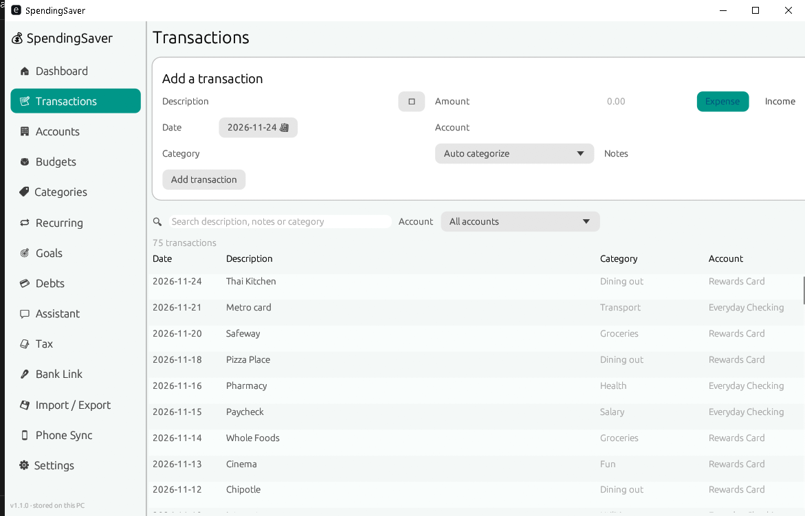<br><b>Transactions</b><br><sub>A virtualised table that stays fast with tens of thousands of rows, with search, an account filter and auto-categorising add.</sub></td></tr>
<tr><td align="center" valign="top">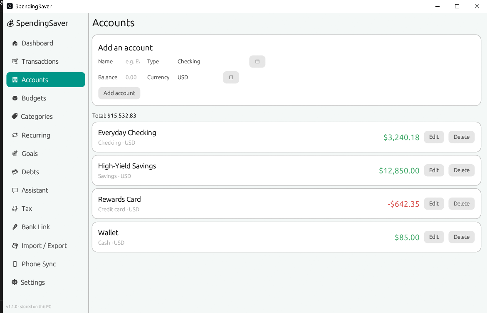<br><b>Accounts</b><br><sub>Add, edit and delete accounts with dropdowns that also accept typed values.</sub></td><td align="center" valign="top">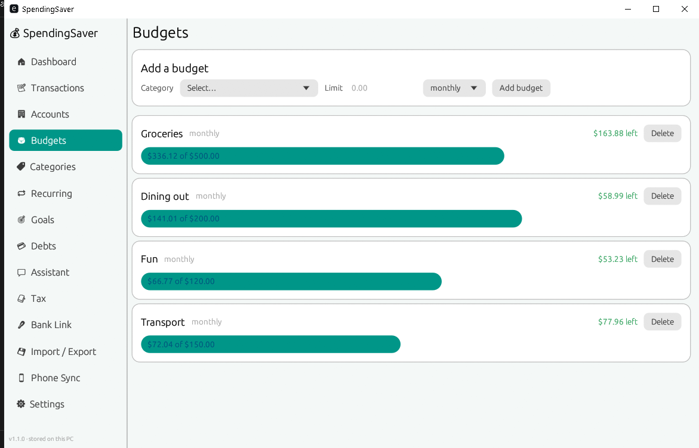<br><b>Budgets</b><br><sub>Limits per category with progress against the current period.</sub></td></tr>
<tr><td align="center" valign="top">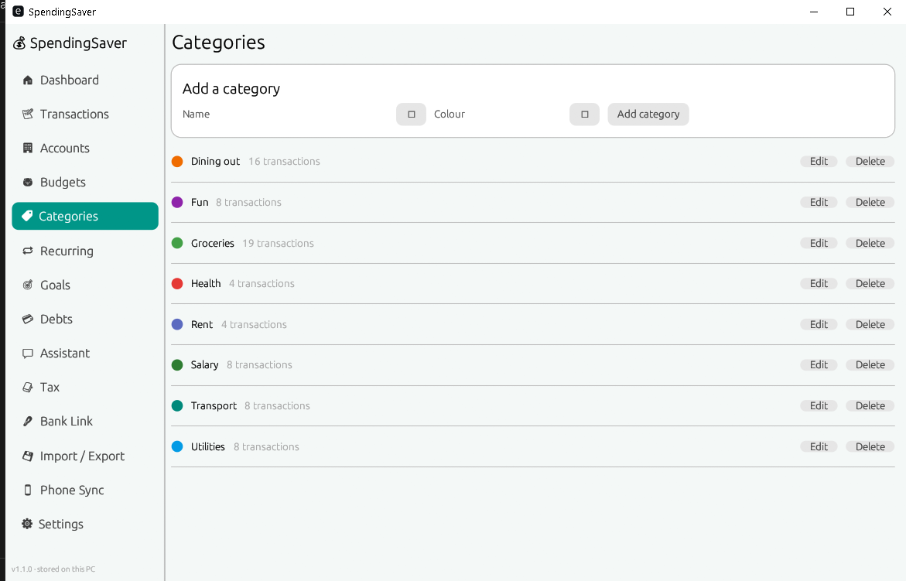<br><b>Categories</b><br><sub>Colour-coded categories with transaction counts.</sub></td><td align="center" valign="top">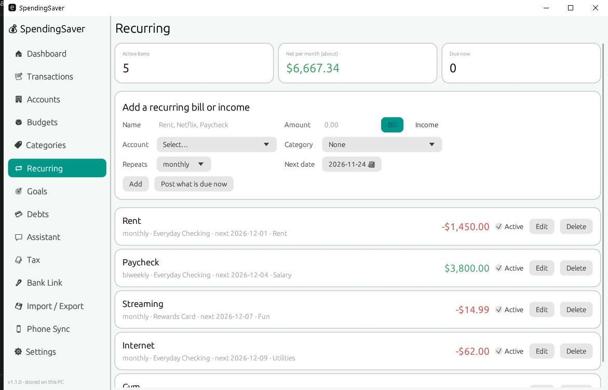<br><b>Recurring</b><br><sub>Bills and income that post themselves when due, including at start-up.</sub></td></tr>
<tr><td align="center" valign="top">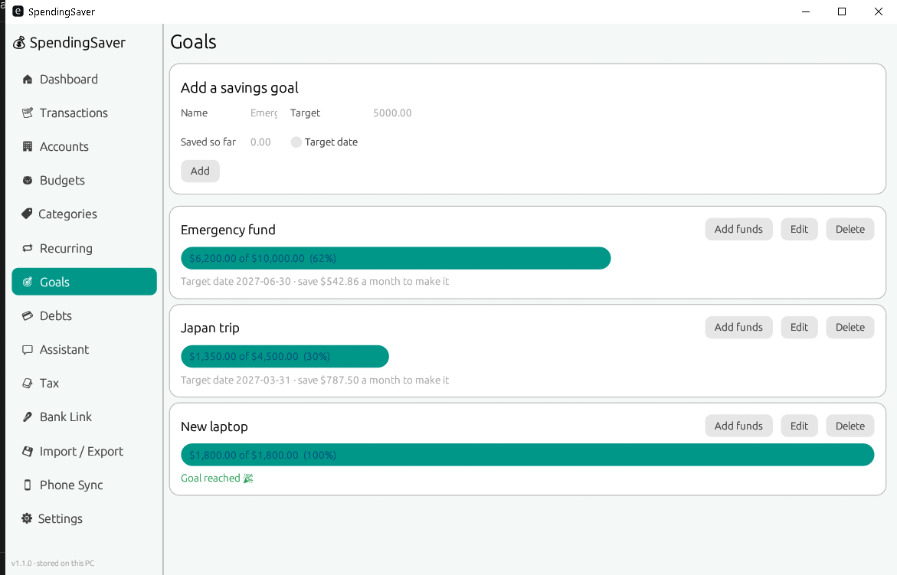<br><b>Goals</b><br><sub>Savings goals with progress, quick add-funds and the monthly amount needed.</sub></td><td align="center" valign="top">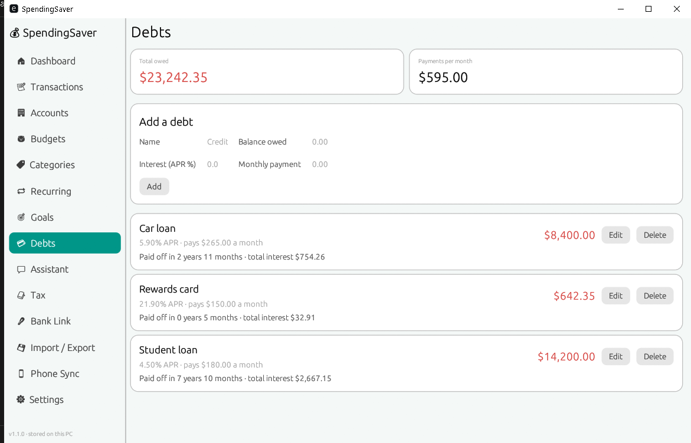<br><b>Debts</b><br><sub>Balances, interest and how long each takes to pay off.</sub></td></tr>
<tr><td align="center" valign="top">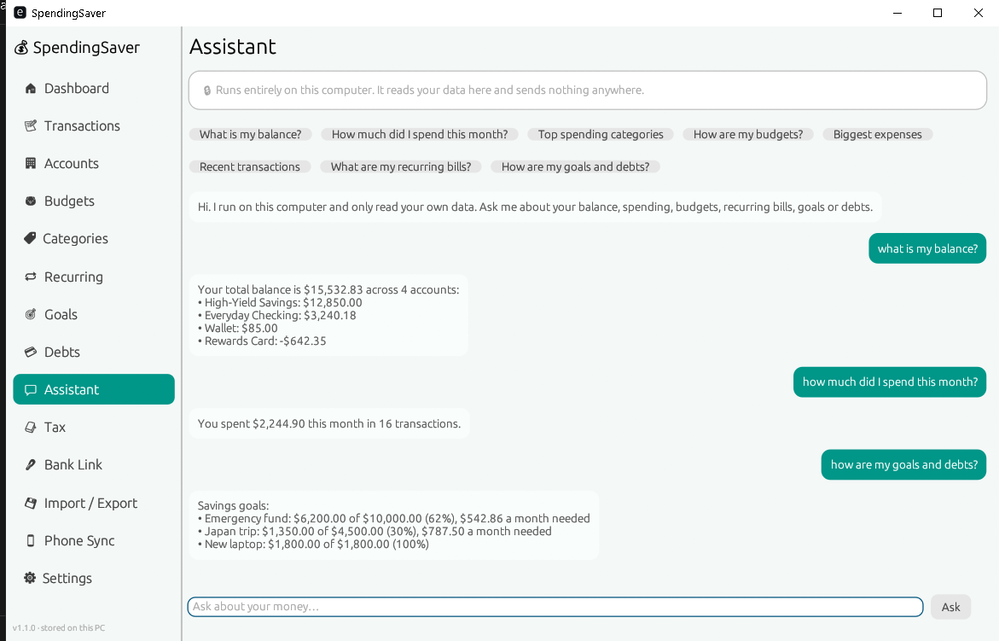<br><b>Assistant</b><br><sub>Ask about balances, spending, budgets, bills, goals and debts. On this PC only, no network.</sub></td><td align="center" valign="top">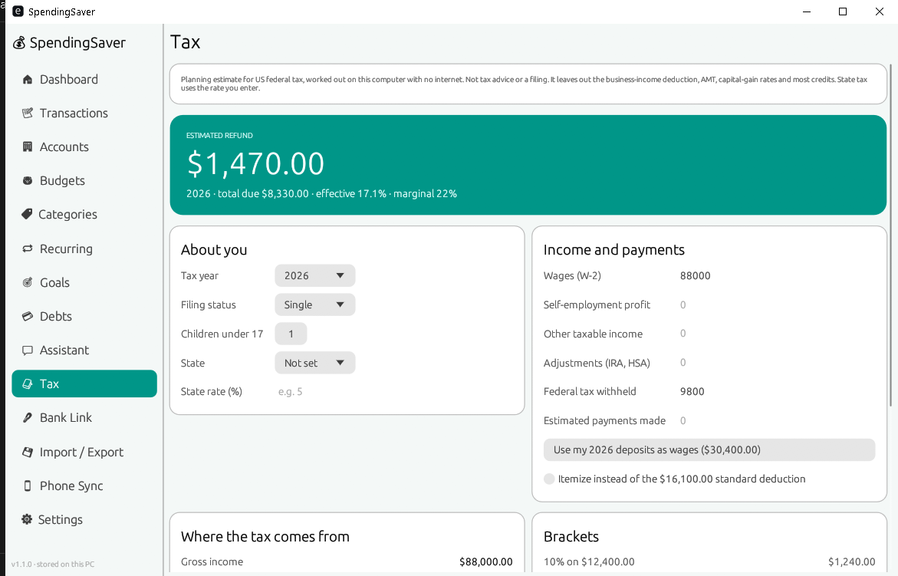<br><b>Tax</b><br><sub>US federal estimate for 2025 and 2026, matching the Android app.</sub></td></tr>
<tr><td align="center" valign="top">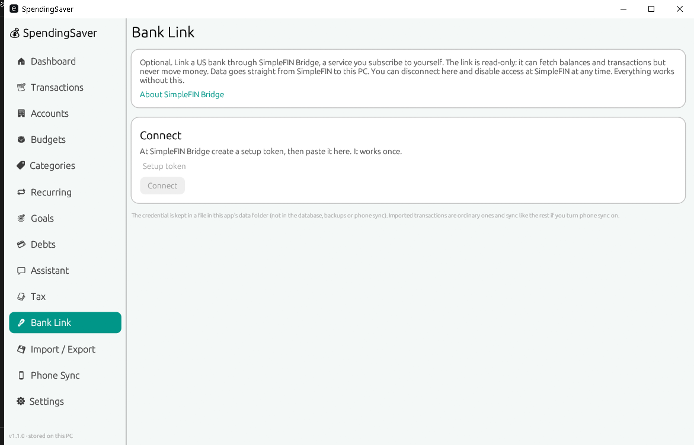<br><b>Bank Link</b><br><sub>Optional read-only SimpleFIN link (US). Off until you connect it.</sub></td><td align="center" valign="top">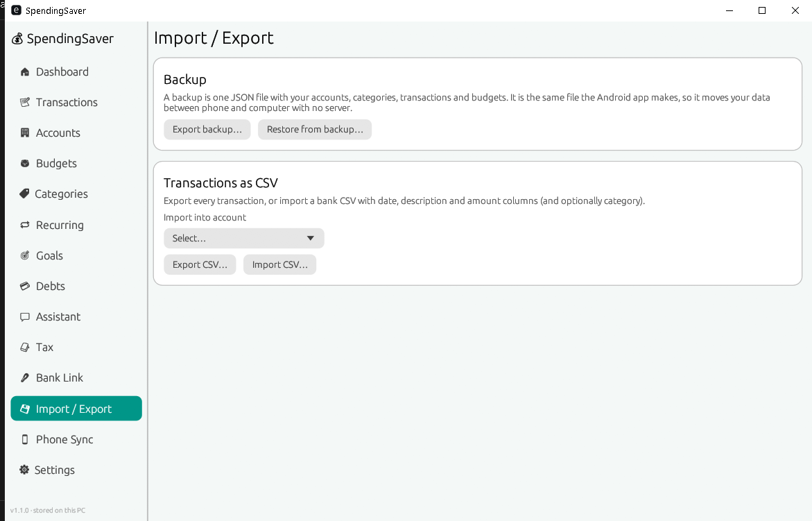<br><b>Import / Export</b><br><sub>JSON backup shared with Android, CSV export and CSV import.</sub></td></tr>
<tr><td align="center" valign="top">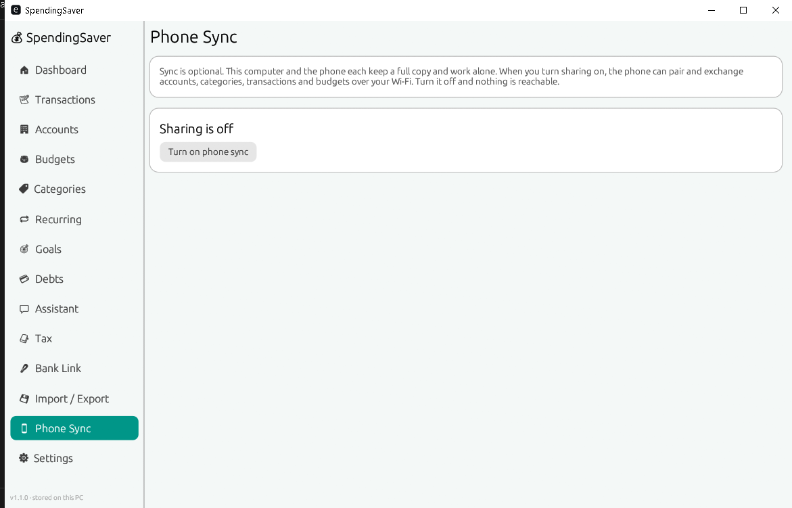<br><b>Phone Sync</b><br><sub>Optional. Turn it on to pair a phone by QR code over your Wi-Fi.</sub></td><td align="center" valign="top">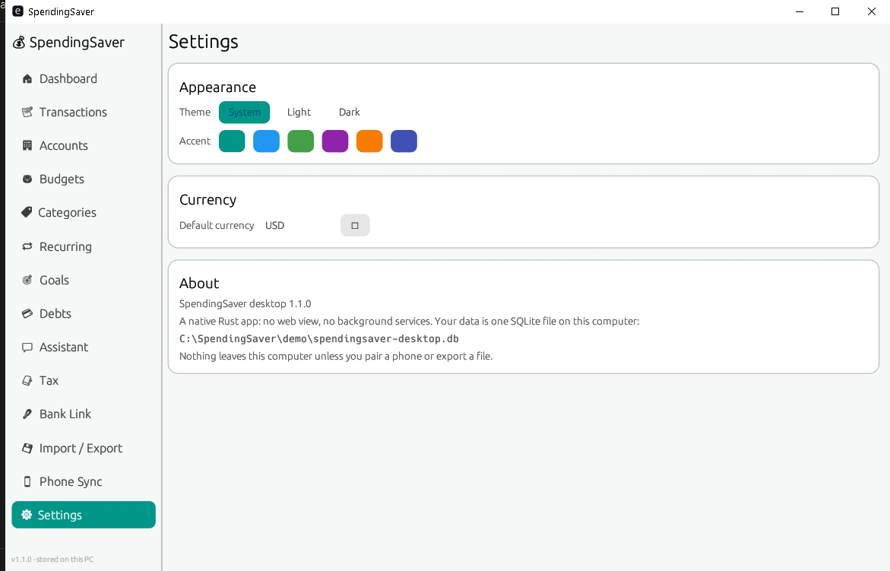<br><b>Settings</b><br><sub>Light, dark or system theme, accent colour and default currency.</sub></td></tr>
</table>

## What is in it

| Page | What it does |
| --- | --- |
| Dashboard | Net worth, this month's income and spending, spending by category, last six months, budgets, recent activity |
| Transactions | Fast scrolling list (rows are drawn only when visible), search, account filter, add / edit / delete, auto-categorise |
| Accounts, Budgets, Categories | Add, edit, delete, with dropdowns that also accept typed values |
| Recurring, Goals, Debts | Bills and income that post themselves when due (also at start-up), savings goals with a monthly need, debt payoff time and interest. Desktop-only; not in the Android backup or phone sync |
| Assistant | Answers questions about your balance, spending, budgets, bills, goals and debts. Runs on this PC, no network, no model download |
| Tax | US federal estimate for 2025 and 2026 (same engine and numbers as the Android app); a planning aid, not tax advice |
| Import / Export | JSON backup (the same file the Android app makes), CSV export, CSV import |
| Bank Link | Optional read-only SimpleFIN Bridge link (US). The credential is a file in the data folder, never in the database, backup or sync |
| Phone Sync | Optional. Turn it on to pair a phone by QR code over your Wi-Fi |
| Settings | Light / dark / system theme, accent colour, default currency |

## Data

`%APPDATA%\SpendingSaver\spendingsaver-desktop.db` (override the folder with `SPENDINGSAVER_DATA`). It is SQLite
in WAL mode. Deleting something marks it deleted (a tombstone) so sync can carry the deletion. The data model matches
the Android JSON backup, so Export here → Restore there (and back) works with no server.

The app does not talk to the network unless you turn on Phone Sync (local network only) or connect the optional bank link (HTTPS to simplefin.org only).

## Layout

`src/main.rs` window start-up · `app.rs` pages and state · `db.rs` SQLite · `model.rs` records ·
`calc.rs` totals and budgets · `extras.rs` recurring, goals, debts · `assistant.rs` on-device answers · `bank.rs` SimpleFIN link · `more.rs` their pages · `tax.rs` tax engine · `hub.rs` sync protocol v1 server ·
`sync_page.rs` pairing screen and QR · `ui.rs` theme and widgets.
