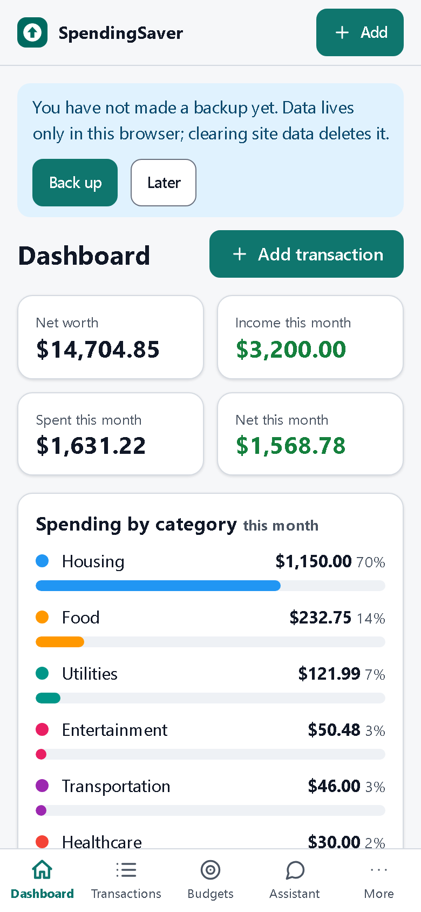
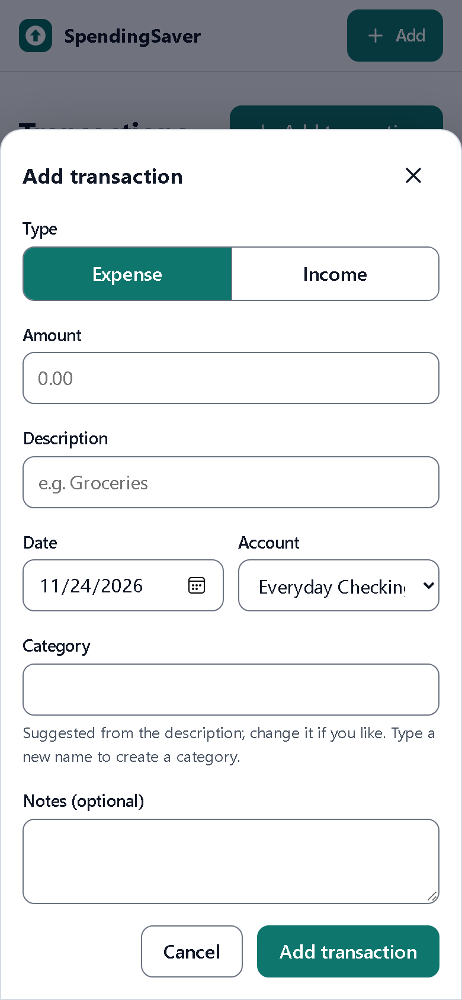
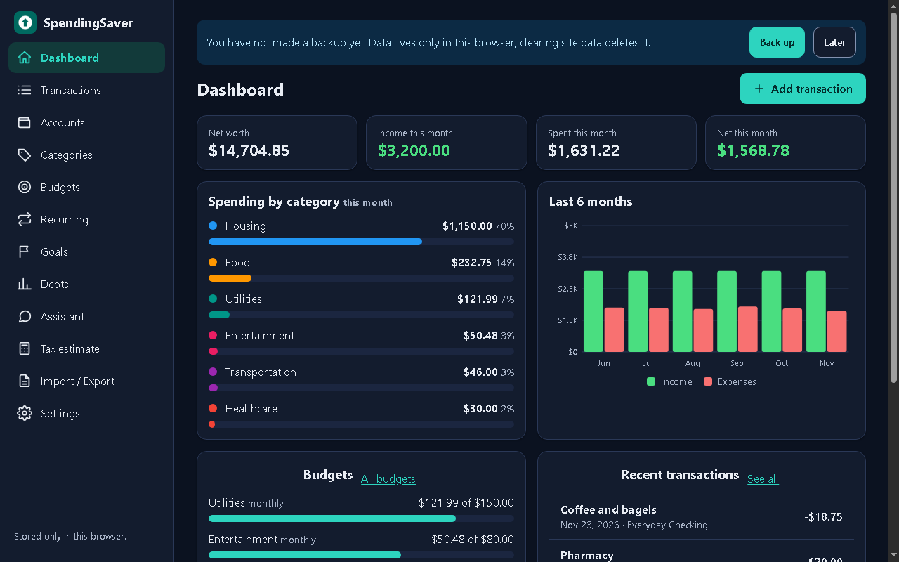
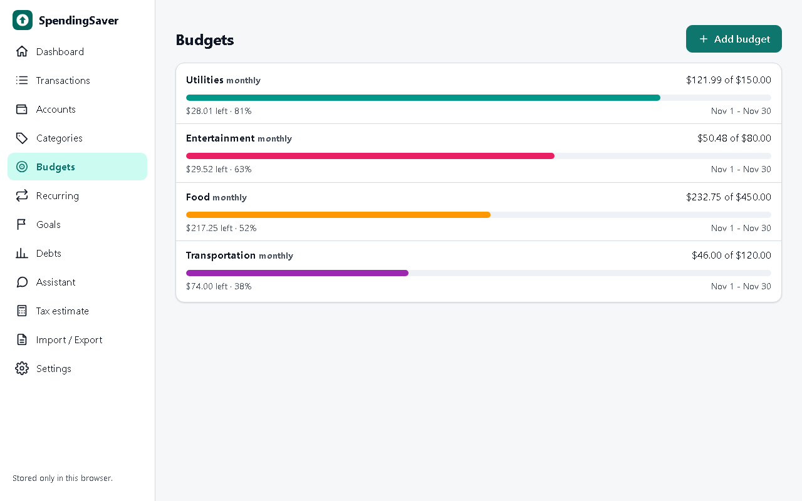

# SpendingSaver for the browser

An installable, offline-capable web app (PWA) version of SpendingSaver. It is a
standalone project: React, TypeScript, Vite and IndexedDB (via Dexie). **All
data stays in your browser on your device.** There is no server, no account, no
analytics and no third-party network request (the page's Content-Security-Policy
allows `connect-src 'self'` only). It is separate from the Android app and the
desktop app; nothing synchronises automatically.

| | |
| --- | --- |
| Phone |   |
| Desktop |   |

Screenshots use the built-in sample data ("Try with sample data"), taken in
Microsoft Edge (headless) from the production build.

## Features

- Dashboard: net worth, this month's income and spending, spending by category,
  6-month income/expense chart (plain SVG, no chart library).
- Accounts, categories (colour), transactions (add/edit/soft delete with Undo,
  search, filter by account/category/type, paginated list), category
  auto-suggestion from the description (Android keyword rules plus history of
  your own choices).
- Budgets (weekly/monthly/yearly) with progress, recurring items that post when
  due, savings goals, debt payoff calculator (single debt and avalanche vs
  snowball).
- Offline assistant (rule-based pure functions, no model, no network).
- US federal tax estimate: a port of the Android `TaxEngine` with the same 2025
  and 2026 constants; the unit tests repeat the Android `TaxEngineTest` cases.
- CSV import/export and JSON backup/restore (see "Data and files").
- Light/dark/system theme, six accent colours, keyboard accessible, 44 px touch
  targets, reduced-motion respected.

## Run, build, test

Requires Node.js (developed on Node 22) and npm. From this directory:

```powershell
npm ci
npm run dev        # development server; the service worker is NOT registered in dev
npm run typecheck  # tsc for the app and for the build scripts (this project's "lint")
npm test           # Vitest: unit + storage tests; build consistency tests run if dist/ exists
npm run build      # typecheck, then vite build into dist/ (also writes dist/sw.js)
npm run preview    # serve dist/ at http://localhost:4173 (what you should test the PWA against)
npm run verify     # typecheck, test, build, test again against the fresh build
npm run icons      # regenerate public/icons and public/icon.svg (only if the design changes)
```

There is no ESLint configuration; `typecheck` (strict TypeScript with unused
checks) is the only static check. GitHub Actions is not used for this repo, so
run `npm run verify` locally (or `scripts/check.ps1 -Only web` from the repo
root, which runs `npm test`).

### Tests

`npm test` runs 85 tests (Node environment, `fake-indexeddb` for IndexedDB):
money parsing/formatting and integer-cent math, dates/periods, budgets,
recurring posting (including idempotency), debt payoff, auto-categorisation,
CSV parsing/import/export round trip (including spreadsheet-formula escaping),
JSON backup parsing/validation/round trip against a fixture in the Android
format (`src/test/fixtures/android-backup.json`) and the desktop app's sample,
restore planning (mirrors Android's `BackupPlanner`), assistant answers (same
scenario as the desktop tests), tax parity with the Android tests, the storage
layer (persistence, soft delete, memory fallback, failed writes, migration of
the earlier prototype database), and, when `dist/` exists, that the manifest,
icons, `index.html` and the service worker's precache list agree with the
actual build output.

Not covered: React components and pages (no component tests), real-browser
IndexedDB quirks beyond what was tried by hand, and the service worker's runtime
behaviour (checked manually, see "Verified").

## Data and files

Stored in IndexedDB, database `spendingsaver-web`, in your browser profile and
for this site's origin only (a different address, browser or profile has
different data). Tables: `accounts`, `categories`, `transactions`, `budgets`,
`recurring`, `goals`, `debts`, `settings`.

- Money is an integer number of hundredths of the currency unit (`...Cents`);
  floats appear only when reading/writing the JSON backup. Totals never add
  different currencies together and there is no conversion.
- Every record has `id` (UUID string), `updatedAt` (epoch ms) and `deleted`
  (soft-delete tombstone), the same trio the Android/desktop apps use and
  `spendingsaver-desktop/docs/sync.md` describes. `updatedAt` is indexed. **This
  is only preparation: sync to the hub is future work and is not implemented. Do
  not expect changes to appear in the other apps.**
- Account `balance` is the figure you enter. Transactions do not change it, as in
  the Android and desktop apps.
- Recurring items, goals and debts exist only in this browser and are not part
  of the backup file (like the desktop app, where they are desktop-only).
- **JSON backup** (Import / Export): the same version-1 document as the Android
  and desktop apps (accounts, categories, transactions, budgets; camelCase,
  decimal amounts). A file exported from either app can be restored here and
  vice versa. Restore replaces the active data; rows missing from the file are
  kept as tombstones, as Android does. Files are validated before anything
  changes (size cap 25 MB, version, required fields, lengths, dates, colours,
  periods, duplicate ids, row-count limits). The round-trip tests use a fixture
  written to match the Android field layout and the desktop app's test JSON; I
  have not restored a real file exported by a phone or the desktop app.
- **CSV**: header row with `Date`, `Description`, `Amount`; optional `Account`
  and `Category`. Dates `YYYY-MM-DD` or `M/D/YYYY`. Bad rows are skipped and
  listed by line number. Limits: 5 MB, 20,000 rows. Export prefixes cells that
  start with `= + - @` with an apostrophe so spreadsheets do not run them as
  formulas; import removes it again.
- **Clearing site data deletes your data.** The app says so in the UI. It asks
  the browser for persistent storage once you have data (Settings shows whether it
  was granted), but only a backup file is a real safeguard.
- If IndexedDB is unavailable (some private modes, blocked site data) the app
  keeps working in memory, shows a persistent warning, and nothing survives
  closing the tab.
- Data from the earlier prototype of this web app (database `SpendingSaverDB`)
  is converted once on first run and the old database is left in place.

Security notes: user text is rendered by React (no `innerHTML`); there is no
`eval`; imports are size-capped and validated; the CSP forbids inline scripts and
all outside hosts.

## PWA and offline behaviour

- `manifest.webmanifest`: name SpendingSaver, standalone, relative `start_url`
  and `scope` (`./`) so it works from a sub-folder, 192/512 icons (any and
  maskable), shortcuts "Add transaction" and "Budgets". A manifest holds one
  `theme_color`; light/dark browser-bar colours come from the two
  `theme-color` meta tags in `index.html`.
- `sw.js` is generated at build time from `build/sw.template.js`. It precaches
  every emitted file under a cache named by a content hash, serves the cached
  shell for every navigation (this is the offline fallback) and never touches
  other origins.
- **Updates:** a new build installs in the background and *waits*. The app then
  shows "Update available - Reload". The Reload button is disabled while any
  form with unsaved edits is open, and the page only reloads after you press it.
  The app checks for updates on load, when the tab becomes visible again and
  hourly.
- **Install:** a banner/button appears when the browser fires
  `beforeinstallprompt` (Chromium); on iPhone/iPad the app shows the "Share, Add
  to Home Screen" instructions.
- Service workers need HTTPS or `localhost`.

## Deploying to static hosting

Build with `npm run build` and upload the contents of `dist/`. The base path is
relative and routing uses the URL hash (`#/transactions`), so no server rewrites
are needed.

- **GitHub Pages project site** (`https://user.github.io/repo/`): publish `dist/`
  to the `gh-pages` branch or the Pages source folder. It works in the sub-folder
  as built. Pages cannot set headers: the `<meta>` CSP in `index.html` applies,
  `_headers` is ignored, and Pages serves files with `max-age=600`, so an update
  can take about 10 minutes to be noticed (the service worker script is fetched
  bypassing the HTTP cache, which also helps).
- **Domain root** (Netlify, Cloudflare Pages, nginx, S3 + CDN): same files. `dist/_headers`
  carries the recommended headers for hosts that read that file.

Recommended response headers (for hosts where you can set them):

| Path | Header |
| --- | --- |
| `/assets/*` | `Cache-Control: public, max-age=31536000, immutable` (file names are hashed) |
| `/sw.js`, `/index.html`, `/`, `/manifest.webmanifest`, `/theme-init.js` | `Cache-Control: no-cache` |
| all | `Content-Security-Policy: default-src 'self'; script-src 'self'; style-src 'self'; img-src 'self' data: blob:; font-src 'self'; connect-src 'self'; manifest-src 'self'; worker-src 'self'; object-src 'none'; base-uri 'self'; form-action 'self'; frame-ancestors 'none'` |
| all | `X-Content-Type-Options: nosniff`, `Referrer-Policy: no-referrer` |

`frame-ancestors` cannot be set from a `<meta>` tag, so it only applies where you
set real headers. Serve `.webmanifest` as `application/manifest+json` and `.js`
as a JavaScript type.

## Browser support

Needs a current browser with IndexedDB, `<dialog>`, ES2020 and CSS variables.
Offline/install need service workers and a secure context: Chrome, Edge, Firefox
and Safari 16+ have them. Install prompts: Chromium browsers; Safari on
iOS/iPadOS uses Add to Home Screen. I only ran it in Microsoft Edge (Chromium
engine, driven through the DevTools protocol); Firefox and Safari are untested.

## Verified (and not)

Checked on the production build served by `vite preview` on `localhost`, driven
through the DevTools protocol in Edge: the service worker registers and
activates; the 22 precached files are in the cache; the manifest parses with no
errors and the installability check returns none; adding an account and a
transaction survives a reload; with the network switched off the reloaded app
shows the saved data and other routes still load; a rebuilt version produces an
"Update available" banner whose Reload button is disabled while a form is open
and, once pressed after closing the form, swaps the cache and keeps the data; no
horizontal scrolling and no controls under 44 px at 360, 768 and 1280 px on every
page; no uncaught exceptions. Entry JS is about 95 KB gzipped (about 120 KB with
every page chunk).

Not done or not verified:

- No sync with the desktop hub or Android app (see above).
- Not tested on a real phone, Safari, Firefox or a screen reader. Contrast is
  designed to WCAG AA by choosing the colours, but was not measured with a tool.
- The persistent-storage request was not granted in the headless test browser, so
  that path was only seen as "not granted".
- Restoring a real Android/desktop backup file has not been tried.
- No ESLint, no component tests, no end-to-end test suite in the repository (the
  browser checks above were manual).
- Currency is stored in hundredths for every currency, so zero-decimal
  currencies (JPY) display two decimals only through `Intl` rounding rules and
  are not fully modelled.
- The tax estimate is a planning estimate only; it shares the Android engine's
  simplifications. Keep its constants in step with Android's `TaxEngine.kt`.
- The in-app (Claude desktop) preview browser cannot register service workers, so
  the offline checks above used Edge.
